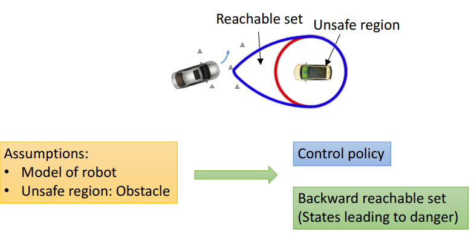
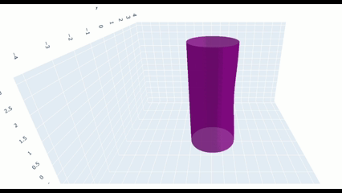
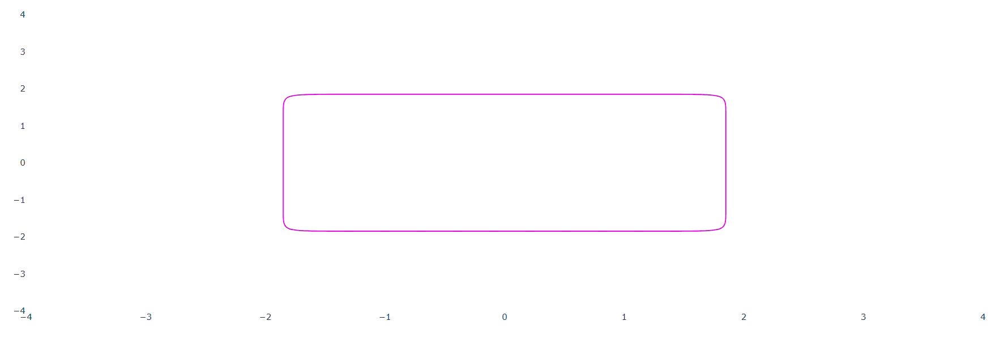
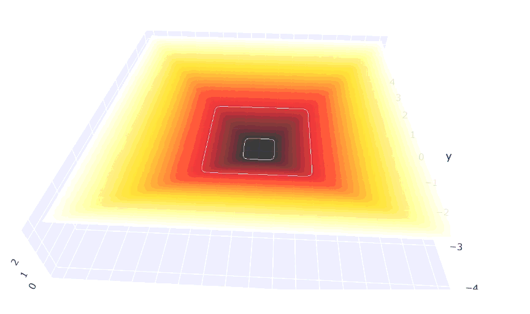

# Optimized Dynamic Programming-Based Optimal Control Algorithms (OptimizedDP)
The repo contains implementation of dynamic programming based algorithms in optimal control. Specifically, the solver supports 3 main classes of algorithms: level set based algorithm for solving Hamilton-Jacobi-Issac (HJI) partial differential equation (PDE) arising in reachability analysis and differential games [1], time-to-reach (TTR) computations of dynamical systems in reachability analysis [2], and value-iterations algorithm for solving continuous state-space action-space Markov Decision Process (MDP). All these algorithms share the property of being implemented on a multidimensional grid and hence, their computational complexities increase exponentially as a function of dimension. For all the aforementioned algorithms, our toolbox allows computation up to 6 dimensions, which we think is the limit of dynammic programming on most modern personal computers.
<div align="center">
    
</div>        

<!--  -->

In comparison with previous works, our toolbox strives to be both efficient in implementation while being user-friendly. This is reflected in our choice of having Python as a language for initializing problems and having python-like HeteroCL [3] language for the core algorithms implementation and dynamical systems specification. Our implementation is 7-32x faster than the [Level Set Toolbox](https://github.com/risk-sensitive-reachability/ToolboxLS) and [HelperOC](https://github.com/HJReachability/helperOC), 2-3x faster than [BEACLS](https://hjreachability.github.io/beacls/) implementation in C++, and 5.2-38x faster than [hj_reachability](https://github.com/StanfordASL/hj_reachability) on CPU. Please find more details about using the repo for solving your problems in this page, and should you have any questions/problems/requests please direct the messages to Minh Bui at buiminhb@sfu.ca 

# Quickstart (Ubuntu 18, 20, 22)
Please install with the following instructions:
* Install Anaconda (https://docs.anaconda.com/anaconda/install/linux/)
* Clone this github repo and `cd optimized_dp/`
* Create a virtual environemnt using the provided `environment.yml`

    ``` conda env create -f environment.yml ```
    
* Install the `optimized_dp` repository

    ``` pip install -e . ```
* Note: If you're on Ubuntu 20.04 or 22.04, you may have encounter an error regarding ``` libtinfo5 ```. 
  To fix, please just run this command 

    ```sudo apt install libtinfo5 ``` 

# (Optional) Reproducible environment with Docker
The toolbox relies on HeteroCL 0.3 and LLVM 6.0, which are no longer actively maintained. To make sure the toolbox can still be installed and run in the future, the exact tested environment (HeteroCL 0.3, LLVM 6.0, Python 3.8, Ubuntu 22.04) is provided as a [`Dockerfile`](Dockerfile), and all of its packages are archived on Zenodo: https://doi.org/10.5281/zenodo.24118105

The archive `odp-conda-pkgs-linux-64.tar.gz` contains every conda package of the environment (listed with checksums in [`environment-linux-64.lock`](environment-linux-64.lock)), so the image can be built without access to the conda channels.

You only need [Docker](https://docs.docker.com/get-docker/) installed. Download the archive into the root of this repository, then build the image (on Windows, run the commands in Git Bash or WSL):
```
tar -xzf odp-conda-pkgs-linux-64.tar.gz
docker build --build-context conda-pkgs=./conda-pkgs -t optimized_dp .
```
Leaving out `--build-context conda-pkgs=./conda-pkgs` downloads the same packages from the conda channels instead, as long as they are still available.

Then run the tests, or open a shell with your local copy of the repository mounted:
```
docker run --rm optimized_dp pytest test
docker run --rm -it -v "$PWD:/opt/optimized_dp" optimized_dp bash
```

# Solving the Hamilton-Jacobi-Issac (HJI) PDE
* We provide a few running examples in folder `examples/` for solving HJI PDE (`examples/pursuit_evasion_game.py, dubins_4d_avoid.py, plotting_examples.py`). Typically these examples follow this structures:
```python
# STEP 1: Define grid
grid_min = np.array([-4.0, -4.0, -math.pi])
grid_max = np.array([4.0, 4.0, math.pi])
N = np.array([150, 150, 150])
periodicDims = [2]
g = Grid(grid_min, grid_max, N, periodicDims)

# STEP 2: Generate initial values for grid using shape functions
center = np.zeros(3)
radius = 1.0
ignore_dims = [2]
Initial_value_f = CylinderShape(g, ignore_dims, center, radius)

# STEP 3: Time length for computations
Lookback_length = 1.0
t_step = 0.05

small_number = 1e-5
tau = np.arange(start=0, stop=Lookback_length + small_number, step=t_step)

# STEP 4: System dynamics for computation
sys = DubinsCapture(uMode="max", dMode="min")

# STEP 5: Call HJSolver function
compMethod = { "TargetSetMode": "minVWithV0"} # V_{t+1} <- min(V_{t+1}, l_0): Backward Reachable Tube computation
result_3D = HJSolver(sys, g, Initial_value_f, tau, compMethod, po1, saveAllTimeSteps=True)

# STEP 6: Initialize plotting option
po2 = PlotOptions(do_plot=True, plot_type="value", plotDims=[0,1],
                  slicesCut=[0], colorscale="Bluered", save_fig=False, filename="plots/3D_0_sublevel_set.png", interactive_html=True)

# STEP 7: Call Plotting function
visualize_plots(result_3D, g, po2)
```
Running the above code should result in the isosurface plot in the browser as follow:


## Plotting options
* You can get to specify the types of plots, the slices of the value function to plot in the case of high-dimensional value function through object `PlotOptions`
* If `plot_type=set` in `PlotOptions`, 2D or 3D isosurface (zero level-set) will be plotted. In the case of 2D, the plot will look  like this.


* If `plot_type=val` in `PlotOptions`, the z-axis is the value, and the plot will look like this   



## System dynamics specification
Examples of dynamical system specifications are provided in the folder ```dynamics/```, and has the following structre.  
```python 
import heterocl as hcl

class DubinsCapture:
    def __init__(self, x=[0,0,0], wMax=1.0, speed=1.0, dMax=1.0, uMode="max", dMode="min"):
        self.x = x
        (...)
        self.dMode = dMode

    def opt_ctrl(self, t, state, spat_deriv):
        """
                :param  spat_deriv: tuple of spatial derivative in all dimensions
                        state: x1, x2, x3
                        t: time
                :return: a tuple of optimal disturbances
        """

        (...)
        return (opt_w[0], in3[0], in4[0])

    def opt_dstb(self, t, state, spat_deriv):
        """
            :param spat_deriv: tuple of spatial derivative in all dimensions
                    state: x1, x2, x3
                    t: time
            :return: a tuple of optimal disturbances
        """
        (...)        
        return (d1[0], d2[0], d3[0])

    def dynamics(self, t, state, uOpt, dOpt):
        (...)
        return (x_dot[0], y_dot[0], theta_dot[0])
``` 

### Optional: state-independent disturbance
When computing the artificial dissipation, the solver by default evaluates `opt_dstb` at every grid point, which is exact for any dynamics. If your `opt_dstb` does not use `state`, you can add the class attribute below so that `opt_dstb` is evaluated only once per time step, which saves some computation:
```python
class DubinsCapture:
    dstb_state_dependent = False
```

### Solving reach-avoid game
To specify a reach-avoid game problem, we just need to add an obstacle set and extra method when calling the `HJSolver`.
```python
reach_set = ...
avoid_set = ... 

compMethods = {"TargetSetMode": "minVWithVTarget", "ObstacleSetMode": "maxVWithObstacle"} 

result = HJSolver(sys_dynamics, grid, [reach_set, avoid_set], tau, compMethods, po, saveAllTimeSteps=None) 

```


# Time-to-Reach computation
* We have provided an example in [`examples/TTR_example.py`](https://github.com/SFU-MARS/optimized_dp/examples/TTR_example.py):
```python
# -------------------------------- ONE-SHOT TTR COMPUTATION ---------------------------------- #
g = Grid(minBounds=np.array([-3.0, -1.0, -math.pi]), maxBounds=np.array([3.0, 4.0, math.pi]),
         pts_each_dim=np.array([50, 50, 50]), periodicDims=[2])
# Car is trying to reach the target
my_car = DubinsCar(uMode="min")

# Initialize target set as a cylinder
targetSet = CylinderShape(g, [2], np.array([0.0, 1.0, 0.0]), 0.70)
po = PlotOptions( "3d_plot", plotDims=[0,1,2], slicesCut=[],
                  min_isosurface=lookback_length, max_isosurface=lookback_length)

# Convergence threshold
epsilon = 0.001
V_0 = TTRSolver(my_car, g, targetSet, epsilon, po)
```
# Discretized Value Iterations
The solver also computes the optimal value function of a discrete-time MDP whose state space is the same multidimensional grid (2D-6D supported). You specify the problem as a class with two methods, `transition` and `reward`, and pass an array of actions:

```python
g = Grid(minBounds=np.array([-math.pi, -8.]), maxBounds=np.array([math.pi, 8.]), pts_each_dim=np.array([201, 401]))

# Action space: a 1D array of actions, or a 2D array of shape (num_actions, num_inputs)
torques = np.linspace(-2., 2., 41)

V = solveValueIteration(pendulum_system, grid=g, action_space=torques,
                        gamma=np.array([0.99]), epsilon=np.array([1.117e-5]),
                        maxIters=np.array([1500]))
```
Iteration stops when `max|V_new - V_old| < epsilon`, or after `maxIters` sweeps.

## MDP system specification
```python
class pendulum_2d_example:
    def __init__(self):
        self.maxTransitions = 1   # number of successor states of one action

    def transition(self, sVals, u):
        # Successor states of action u taken at state sVals.
        # Returns a matrix of shape (maxTransitions, 1 + dims), where row i is
        # [probability, next_state_0, ..., next_state_{dims-1}]. The probabilities must sum to 1.
        trans_matrix = hcl.compute((self.maxTransitions, 1 + 2), lambda *x: 0, "trans_matrix")
        (...)
        trans_matrix[0, 0] = 1.0            # deterministic: one successor, probability 1
        trans_matrix[0, 1] = new_th[0]
        trans_matrix[0, 2] = newthdot[0]
        return trans_matrix

    def reward(self, sVals, u):
        # Immediate reward of taking u at sVals. Returns a scalar.
        rwd = hcl.scalar(0, "rwd")
        rwd[0] = -(sVals[0] * sVals[0] + 0.1 * sVals[1] * sVals[1] + 0.001 * u * u)
        return rwd[0]
```
Notes:
* `sVals` holds the continuous state of the grid point; `u` is one entry of `action_space`. If `action_space` is 2D, `u` is a row, so a system with two inputs reads them as `u[0]` and `u[1]`.
* Both methods are traced into the compute graph, so they are written in HeteroCL (`hcl.scalar`, `hcl.if_`, `hcl.sin`, ...), in the same style as the dynamics classes.
* Successor states are mapped back to the grid by nearest-neighbour lookup, so keep them inside the grid bounds (clip them in `transition` if the dynamics can leave the domain).
* The first value of the row is the probability of the next state happening
* For a stochastic system, set `maxTransitions` to the number of successor states and fill one row per outcome.

## Examples
The examples are in [`odp/MDP_example/`](odp/MDP_example/) and are run directly, e.g. `python3 odp/MDP_example/pendulum_valueIter_example.py`:
* [`pendulum_valueIter_example.py`](odp/MDP_example/pendulum_valueIter_example.py): inverted pendulum using the OpenAI Gym dynamics and reward.
* [`double_integrator_example.py`](odp/MDP_example/double_integrator_example.py): double integrator with an LQR cost
* [`planar_6d_quad_valueIter.py`](odp/MDP_example/planar_6d_quad_valueIter.py): 6D planar quadrotor reach-avoid problem.

# Current Project Structure
* `solver.py`: the python APIs of the toolbox - `HJSolver`, `TTRSolver` and `solveValueIteration`. Each one builds the compute graph for the dimension of the given grid, then runs the time/iteration loop.
* `Grid/`: the `Grid` class - bounds, number of points per dimension, periodic dimensions, grid spacing `dx`, and helpers to convert states to indices (`get_indices`, `get_values`).
* `dynamics/`: user's dynamical system specification - one class per system, providing `opt_ctrl`, `opt_dstb` and `dynamics`. Add your own system here and import it in your running example.
* `Shapes/ShapesFunctions.py`: add-in functions for initializing different shapes/initial value functions (cylinders, rectangles, ellipsoids, half-spaces, and unions/intersections of them).
* `computeGraphs/`: the core HJ PDE solver, as one `graph_*D.py` per dimension (1D-8D). Each builds the HeteroCL graph of the Hamiltonian and dissipation stages and the CFL time step.
  * `computeGraphs/CustomGraphFunctions.py`: ready-to-use HeteroCL style utility functions (min/max, absolute value, reductions) used by the graphs.
* `spatialDerivatives/`, `common/derivatives.py`: upwind spatial derivatives - first-order ENO and second-order ENO, in HeteroCL and in NumPy respectively.
* `TimeToReach/`: the time-to-reach solver, one `TimeToReach_*D.py` per dimension (1D-8D), solving the stationary HJ equation by value iteration until convergence.
* `valueIteration/`: the MDP value iteration graphs, one `value_iteration_*D.py` per dimension (2D-6D).
* `MDP_example/`: runnable value iteration examples (see above).
* `Plots/`: plotting utilities - `plot_isosurface` and `plot_valuefunction`, with slicing and downsampling of high-dimensional value functions.
* `compute_trajectory.py`, `compute_trajectory_TTR.py`: roll out optimal trajectories from a computed value function (`compute_opt_traj`, `compute_opt_traj_TTR`).
* `examples/`: runnable reachability examples. `test/`: the test suite, run with `pytest test`.

# Running tips
* Notes: For 6 dimensions, recommended grid size is 20-30 each dimension on system with 32Gbs of DRAM.
* Create a class file in folder dynamics/ to specify your own system dynamics. Remember to import the class in your running example.  

### Paper and Citation (Bibtex)  
Please cite our paper (https://arxiv.org/abs/2204.05520) if you use the toolbox in your research:
```
@misc{https://doi.org/10.48550/arxiv.2204.05520,
  doi = {10.48550/ARXIV.2204.05520},
  url = {https://arxiv.org/abs/2204.05520},
  author = {Bui, Minh and Hu, Hanyang and He, Chong and Lu, Michael and Giovanis, George and Shriraman, Arrvindh and Chen, Mo},
  keywords = {Systems and Control (eess.SY), FOS: Electrical engineering, electronic engineering, information engineering, FOS: Electrical engineering, electronic engineering, information engineering},
  title = {OptimizedDP: An Efficient, User-friendly Library For Optimal Control and Dynamic Programming},
  publisher = {arXiv},
  year = {2022}, 
  copyright = {Creative Commons Attribution 4.0 International}
}
```  


# Related Projects
### MATLAB
* [A Toolbox of Level Set Methods ](https://www.cs.ubc.ca/~mitchell/ToolboxLS/)
* [helperOC](https://github.com/HJReachability/helperOC)
### C++
* [BEACLS](https://hjreachability.github.io/beacls/)
### Python/JAX
* [hj_reachability](https://github.com/StanfordASL/hj_reachability)

# References
[1] "Hamilton–Jacobi Reachability: Some Recent Theoretical Advances and Applications in Unmanned Airspace Management" by Mo Chen and Claire J. Tomlin in 
Annual Review of Control, Robotics, and Autonomous Systems 2018 1:1, 333-358 [pdf](https://www.annualreviews.org/content/journals/10.1146/annurev-control-060117-104941)

[2] "One-Shot Computation of Reachable Sets for Differential Games" by Insoon Yang [pdf](https://dl.acm.org/doi/pdf/10.1145/2461328.2461359?casa_token=GmZ6JB2DhLwAAAAA:qRSxxQisIcNpNo6nJHWbi5lRSmxFWk_gL2dXxilkpPi3PsgwxwPSs5hCdcuV7Elx1PTQ84cAGFQ)

[3] "HeteroCL: A Multi-Paradigm Programming Infrastructure for Software-Defined Reconfigurable Computing" by Yi-Hsiang Lai [pdf](https://vast.cs.ucla.edu/~chiyuze/pub/fpga19-heterocl.pdf)

